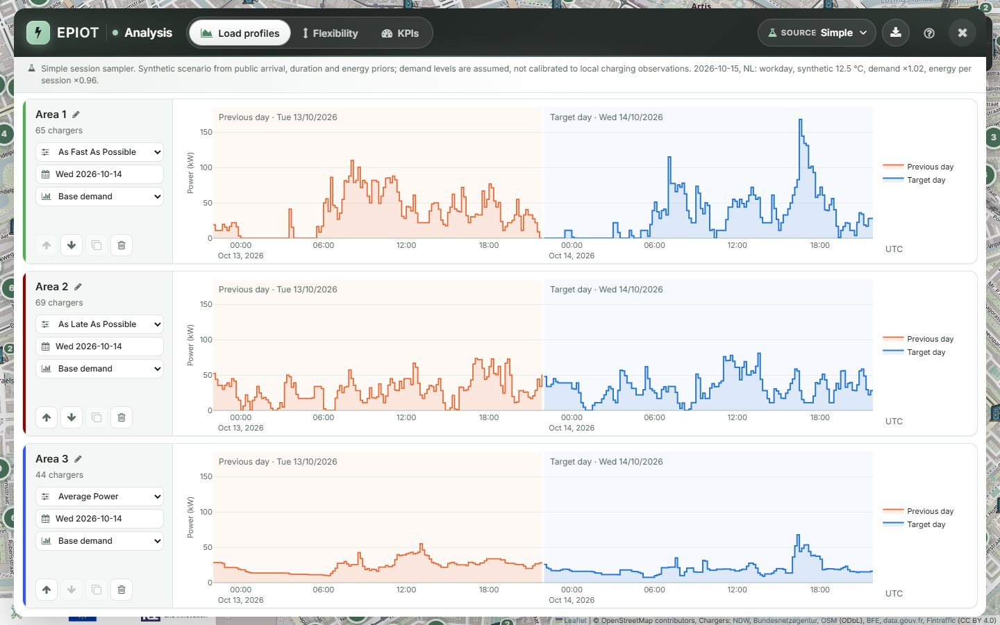

<p align="center">
  <a href="https://drive2x.eu/"></a>
</p>

<h1 align="center">EPIOT</h1>
<p align="center"><strong>Electromobility Prediction Tool</strong><br>
Quantify EV charging load and flexibility for any area on the map.</p>

<p align="center">
  <a href="https://github.com/StavrosOrf/EPIOT/actions/workflows/ci.yml"></a>
  <a href="https://epiot.readthedocs.io/en/latest/"></a>
  
  
</p>

EPIOT is a web application and REST API for estimating how electric-vehicle charging loads behave
in a neighbourhood, a district or a whole city. Draw up to three areas on the map, choose a date, a
session source and a charging strategy, and compare **load profiles**, **flexibility envelopes** and
**KPIs** side by side. Results export to Excel.

It was developed in [DRIVE2X](https://drive2x.eu/) Work Package 5 for charge point operators, grid
operators, city and mobility planners, and researchers.

<p align="center">
  
</p>

> **Scope.** EPIOT receives no live charging data. Every result is a synthetic scenario built from
> public arrival, duration and energy priors, with assumed demand levels. Results are not verified
> forecasts of local charging.

## Features

- **Map of about 590,000 charging points** in the Netherlands, Germany, France, Switzerland, Finland
  and seven further cities, with distribution transformers and a spatial atlas for Amsterdam.
- **Three session sources:** *Simple* (public priors), *Spatial* (neighbourhood-aware) and *CPFT*
  (an offline library built from trained models), each at low, base or high demand with calendar,
  holiday and weather day effects.
- **Five charging strategies:** As Fast As Possible, As Late As Possible, Average Power,
  Min. Carbon Footprint and Min. Charging Cost.
- **Flexibility:** the feasible power and energy envelope with upward and downward headroom.
- **Five KPI dashboards:** User, Grid, Environment, Mobility and City.
- **Reports and API:** an Excel workbook with chart images, and a documented REST API for the same
  analyses.

## Quick start

You need Python 3.11 – 3.13, [uv](https://docs.astral.sh/uv/) and the SpatiaLite SQLite extension.

```bash
git clone https://github.com/StavrosOrf/EPIOT.git
cd EPIOT
uv sync
uv run python scripts/install_spatialite.py   # Windows only; see below for Linux and macOS
uv run python database_init.py                # builds instance/default.sqlite offline
uv run python app.py
```

Open <http://127.0.0.1:5000>.

SpatiaLite on Linux or macOS:

```bash
sudo apt-get install libsqlite3-mod-spatialite   # Ubuntu
brew install libspatialite                       # macOS
```

`database_init.py` needs no downloads or API keys. It restores the snapshots in
[`seed_data/`](seed_data/README.md) and refuses to overwrite an existing database. Use
`--countries NL DE FR` to load only some countries. Do not run `flask db upgrade` before it; for an
existing server, `uv run flask --app app db upgrade` applies new migrations.

<details>
<summary>Optional components</summary>

- **CPFT session source.** It reads the prebuilt `backend/data/cpft_library.npz`, so the standard
  install already supports it. Rebuilding the library needs TensorFlow: `uv sync --extra cpft`.
- **Load-forecasting models** in `backend/ml` need PyTorch: `uv sync --extra ml`.
- **Min. Charging Cost** calls the DRIVE2X ReFlex service, which is reachable only from the project
  network. The other four strategies run entirely locally.
- **Charger data refresh** from the original suppliers is optional:
  `uv run python scripts/update_charger_data.py` and
  `uv run python scripts/export_country_data.py`.

</details>

<details>
<summary>Windows and OneDrive checkouts</summary>

OneDrive locks files while it uploads them, which makes `uv sync` fail part-way through with
`os error 396` or `os error 32`. `link-mode = "copy"` is already set in `pyproject.toml`, and the
virtual environment should live outside the synced tree, linked in with a junction. Run this
before the first `uv sync`:

```bat
mkdir %USERPROFILE%\.venvs\EPIOT
mklink /J .venv %USERPROFILE%\.venvs\EPIOT
```

</details>

## Documentation

Full documentation is at **<https://epiot.readthedocs.io/en/latest/>**.

| Guide | Reference |
|---|---|
| [Getting started](docs/getting-started.md) | [REST API](docs/rest-api.md) |
| [Map and areas](docs/map-and-areas.md) | [Data schema](docs/data-schema.md) |
| [Session sources](docs/session-sources.md) | [Architecture](docs/architecture.md) |
| [Charging strategies](docs/charging-strategies.md) | [Operations](docs/operations.md) |
| [Load profiles](docs/load-profiles.md), [Flexibility](docs/flexibility.md), [KPIs](docs/kpis.md) | [Building the docs](docs/README.md) |

## Development

```bash
uv run pytest -q            # Python tests
node --test tests/*.mjs     # browser module tests
```

The test layout is described in [`tests/README.md`](tests/README.md) and CI runs both suites on every
push and pull request. The server code lives in [`backend/`](backend/README.md), the browser modules
in [`static/scripts/`](static/scripts) and the page template in [`templates/`](templates).

Contributions are welcome. Open an issue to discuss larger changes first, and update the matching
documentation page in the same pull request as a change to a control, parameter or response field.

## Data and licences

Charger locations come from open national and municipal sources, including NDW, the
Bundesnetzagentur, BFE, data.gouv.fr and Fintraffic. Sources, licences and attribution are listed in
[`seed_data/manifest.json`](seed_data/manifest.json) and under *Data coverage* in
[Getting started](docs/getting-started.md#data-coverage). Check them before redistributing data.

## Citing EPIOT

> Ravanbach, B., Turhan, E., Wulff, N., Orfanoudakis, S., Vergara, P. P., Vahidinasab, V., Dias, L.,
> & Mendes, G. (2024). *A dynamic prediction tool for vehicle-to-grid operation and planning.* In
> *2024 IEEE 22nd Mediterranean Electrotechnical Conference (MELECON)*.

## Team

- [Stavros Orfanoudakis](https://www.stavrosorfanoudakis.com/), TU Delft, lead developer
  (<s.orfanoudakis@tudelft.nl>)
- Babak Ravanbach, DLR, product owner (<babak.ravanbach@dlr.de>)

Past developers: Eugenio Salvador Arellano Ruiz, Elif Turhan and Niklas Wulff (DLR).

EPIOT is developed in DRIVE2X Work Package 5 by DLR and TU Delft together with TNO, Labelec and the
University of Salford.

## Acknowledgements

<p>
  <a href="https://drive2x.eu/"></a>
  &nbsp;&nbsp;
  <a href="https://european-union.europa.eu/"></a>
  &nbsp;&nbsp;
  <a href="https://www.ukri.org/"></a>
</p>

<p>
  <a href="https://www.dlr.de/en"></a>
  &nbsp;&nbsp;
  <a href="https://www.tudelft.nl/en"></a>
  &nbsp;&nbsp;
  <a href="https://www.tno.nl/en"></a>
  &nbsp;&nbsp;
  <a href="https://edp.com/en/innovation/labelec"></a>
  &nbsp;&nbsp;
  <a href="https://www.salford.ac.uk/"></a>
</p>

[DRIVE2X](https://drive2x.eu/) has received funding from the European Union's Horizon Europe
research and innovation programme under Grant Agreement No. 101056934. The UK participants are
funded by UK Research and Innovation (UKRI). Views and opinions expressed are those of the author(s)
only and do not necessarily reflect those of the European Union or the granting authority. Neither
the European Union nor the granting authority can be held responsible for them.

## Licence

EPIOT is released under the BSD-3-Clause licence.
