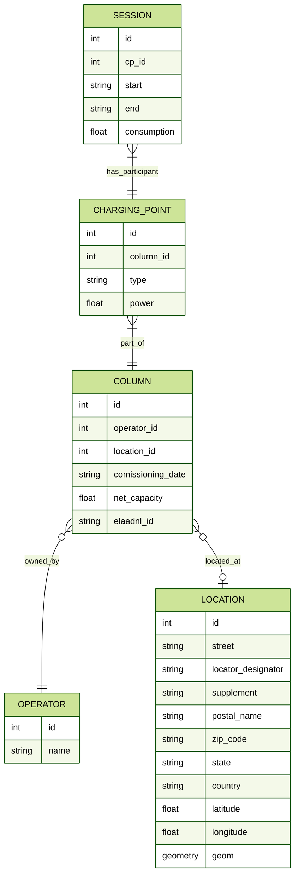

# Operational notes

## Setting up the database

To set up the database for the first time you need to install the requirements and make spatialite available in your system. Conda is the fastest way to do this on windows.

```
conda install libspatialite -c conda-forge
```

Once this is achieved you can first run two times:

```
flask db upgrade
```

The first time might throw an error, don't worry about this
Once this is done proceed to populate the database by running database_init once.

Wit the database setup, you can feed it with data, the inital example uses the file "chargers_data_ams.json" with the amsterdam charging stations. The database can be fed with:

```
python database_init.py
```

## Database Model ERD

> **_NOTE:_** To render the diagram using Markdown live preview in VSCode download the [Markdown Preview Mermaid Support](https://marketplace.visualstudio.com/items?itemName=bierner.markdown-mermaid) plugin .


