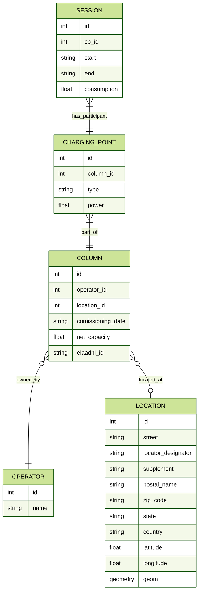

# Operational notes

Install dependencies with `uv sync` and install SpatiaLite as described in the
[root README](../README.md). Initialize a fresh checkout offline with:

```
uv run python database_init.py
uv run python app.py
```

The initializer applies migrations and restores the compact country snapshots
in [seed_data](../seed_data/README.md). No large raw input files or API keys are
required. It refuses to overwrite an existing database. For an existing server,
run `uv run flask --app app db upgrade` to apply new migrations.

Supplier refreshes use `scripts/update_charger_data.py`; regenerate snapshots
with `scripts/export_country_data.py` afterwards. See
[the data model](../docs/architecture/backend.md) and
[charger-source documentation](../docs/charger_sources.md).

## Database Model ERD

> **_NOTE:_** To render the diagram using Markdown live preview in VSCode download the [Markdown Preview Mermaid Support](https://marketplace.visualstudio.com/items?itemName=bierner.markdown-mermaid) plugin .


