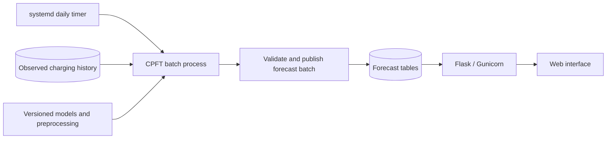

# Daily CPFT forecasting for EPIOT

Assessment date: 13 October 2026. Deployment target: one Linux server or VM, confirmed by the user. This document is an implementation plan; no forecasting service has been installed or enabled.

## Recommended architecture

Use a systemd timer to launch a separate Python forecast job once a day. Keep Flask/Gunicorn running as its own service. The forecast job reads observed history, loads saved CPFT models, calculates predictions outside database transactions, and publishes a versioned batch. HTTP requests read the published results.



Both processes run concurrently on the VM. Start with one forecast process and bounded TensorFlow CPU usage; measure runtime before adding a small process pool. A separate process alone does not prevent CPU or memory contention.

For this daily batch on one machine, systemd avoids adding a broker and queue services. Cron could also launch the command, but systemd provides a natural service lifecycle, logs, resource controls, and missed-trigger recovery. A dedicated APScheduler process is possible, but provides no clear benefit for this fixed schedule. Celery with Redis/RabbitMQ and one Beat scheduler becomes useful if EPIOT later needs distributed workers, many independent jobs, or user-triggered forecasts.

Do not start a scheduler when importing `app.py`: the checked-in Gunicorn command uses four workers, and the development app enables the reloader. Scheduler startup in each web process could create duplicate executions. Keep scheduling independent of web restarts.

## Verified repository findings

| Finding | Evidence | Consequence |
| --- | --- | --- |
| Flask uses SQLite/SpatiaLite. | `app.py:24-35`; `backend/models.py` | Share configuration and the same absolute database path between the web service and job. |
| The Linux launch script uses four Gunicorn workers. | `scripts/run_file.sh:7` | Forecast scheduling must have its own process lifecycle. |
| The current update script generates 100 days of Monte Carlo sessions on each invocation. | `update_database.py:52-57` | Add a dedicated forecast command rather than scheduling this script for CPFT. |
| The `ML` branch falls back to random session generation; CPFT has no integration in the active backend. | `backend/charge_sessions.py:83-87,136-191`; search of app/backend/scripts/migrations | Build an explicit CPFT adapter. |
| Sessions contain only point ID, start, end, and consumption. | `backend/models.py:93-100`; read-only SQLite inspection | Observations, simulations, and predictions currently lack distinct provenance. |
| The local database has 717 columns/stations, 1,399 charging points, and 318,163 sessions. | Read-only inspection of `instance/default.sqlite` | Forecast at charging-point level; aggregate points into stations for display. |
| Local session starts span 30 August 2025 to 10 January 2026; the latest end is 14 January 2026. | Read-only SQLite inspection | This snapshot cannot supply fresh October 2026 observations. Verify the production feed before live forecasting. |
| SQLite currently uses DELETE journaling, and the sessions table has no secondary indexes. | Read-only PRAGMA inspection | Configure concurrency deliberately and add indexes for point/time history queries. |
| CPFT is a top-level script that parses arguments, trains two models for up to 200 epochs each, plots, and exports Excel. | `others/CPFT-main/CPFT-tool/CPFT_VS_Code_Python/CPFT_pipeline_VS_Code_Python.py:51-69,488-491,905-908` | Extract reusable training and inference functions; do not import or execute the full research script daily. |
| CPFT predicts hourly occupied/not-occupied and kWh, rather than individual charging sessions. | CPFT preprocessing at lines 249-331 and output at lines 1393-1397 | Preserve hourly predictions and explicitly derive approximate sessions when needed. |
| CPFT starts forecasting after the last historical hour and has no target-date argument. | CPFT lines 686,735-737 | Add an explicit issue time, observation cutoff, and target interval. |
| Two `.keras` checkpoints are included; the script does not persist the fitted scalers and complete inference configuration. | CPFT outputs and scaler/checkpoint code | A production artifact must contain more than the model weights. |

The local session rows do not identify their origin. The repository includes synthetic session generators, but that does not prove the provenance of every existing database row. Establish provenance before using this table as training data.

The bundled CPFT manual describes a file-based EPIOT integration. That description does not establish an implemented adapter in this checkout; none was found in the active backend. Its recommendation to run inference daily and training less frequently is appropriate here.

## Implementation sequence

1. **Establish observed inputs.** Ingest current, real charging history and record source, observation timestamp, ingestion timestamp, and data coverage. Keep synthetic sessions and forecasts out of training queries. Distinguish missing telemetry from confirmed zero usage. Do not treat future session end times or final energy totals as known at the forecast issue time. For ongoing sessions, use available telemetry or an explicitly documented estimation policy.

2. **Extract a CPFT library.** Add `backend/forecasting/cpft.py` with separate training, artifact loading, and inference functions. Keep TensorFlow imports inside the forecast component so ordinary Flask workers do not initialize it. Manage a CPFT dependency extra through `pyproject.toml` and `uv.lock`; resolve and verify it on Linux. The checked-in `.venv` currently points to an unavailable interpreter on another user's machine, so rebuild from the lockfile rather than relying on it.

3. **Define an artifact bundle.** Persist both models, fitted scalers, feature ordering, clipping parameters, occupancy threshold, sequence length, timezone convention, training cutoff, model version, code version, and validation results. Train initially, then retrain on a separate weekly/monthly schedule or when validation indicates drift. Promote a candidate only after chronological validation against simple baselines. Select point-specific or pooled models based on data sufficiency and validation; the supplied single-point example is not evidence of accuracy across Amsterdam.

4. **Build the daily command.** Add `scripts/forecast_next_day.py`, with explicit `--target-date YYYY-MM-DD` and a scheduled mode that reconciles which forecast is due. Snapshot all charging-point IDs from the database, including points outside the current hardcoded NL filter. Load a bounded history window and model once per relevant point/group, close read transactions, compute, then pass results to one writer. Every inventoried point must end with a status: CPFT result, validated fallback, or unavailable with a reason. Zero predicted sessions is a valid result distinct from failure.

5. **Add forecast persistence and publication.** Use an Alembic migration to add the tables below. Save staging batches in short transactions, then atomically change the published run for a target date after validation. Existing readers continue using the previous published run while a new one is calculated. Explicitly mark partial coverage; never silently present a partial aggregate as a forecast for all stations.

6. **Integrate read paths.** Add a forecast status endpoint and a repository function for fetching published point/hour forecasts and derived sessions. Update `/stations/aggregate_load` and downstream simulation inputs to select forecast sessions for the requested date. Preserve observed sessions as observations. Fetch sessions using interval overlap (`start < window_end AND end > window_start`) so overnight sessions are included. Show target date, generation time, source/fallback status, and coverage. If the requested day has no usable forecast, report that fact rather than silently substituting a different day's forecast.

7. **Deploy the timer and service.** Run daily after the observation feed's expected update and sufficiently before next-day delivery. An illustrative schedule is 18:00 Europe/Amsterdam; the final time depends on the data feed and measured runtime. Use an absolute interpreter path, working directory, database URL, model directory, and service account. Initialize SpatiaLite consistently through shared configuration, without starting a web server from the job.

Proposed tables:

| Table | Purpose and key fields |
| --- | --- |
| `forecast_runs` | ID, issue time, observation cutoff, target date/timezone, model/config versions, status, expected/success/fallback/failure counts, start/end times. |
| `forecast_point_status` | Unique `(run_id, cp_id)`, source/model version, status, history freshness, error/fallback reason; records valid zero-session results. |
| `forecast_hourly` | Unique `(run_id, cp_id, timestamp_utc)`, occupancy probability, occupancy binary, energy_kwh, interval duration. |
| `forecast_sessions` | Unique `(run_id, cp_id, session_index)`, start/end UTC, energy_kwh, derivation method, boundary/censoring flags. |
| `forecast_publications` | One active run ID per target date/timezone; swap only after validating the candidate batch. |

Keep task attempts separate from forecast revisions. Retries for an existing run upsert the same point/hour keys. An intentional recomputation creates a new revision and replaces the publication pointer, preserving auditability without duplicate aggregation. Use a process lock for the batch job, and recover abandoned run records after a crash. Store and reuse the original target date and observation cutoff during retries, including retries after midnight.

## CPFT semantics and corrections required

**Hourly output is not an identifiable session forecast.** In the provided code, `availability = 1` means occupied. A compatibility adapter can group consecutive occupied hours into approximate sessions and sum their energy, but hourly bins cannot reveal multiple short sessions within an hour or separate adjacent sessions. Label these as CPFT-derived sessions. Exact arrival/departure forecasting would require an additional session-level model or validated disaggregation method.

Validate energy against charger power and connection duration, handle known carry-in sessions, and preserve sessions crossing midnight. Extend the forecast beyond the target day if needed to estimate departures; when no departure is predicted within the horizon, mark it as censored rather than inventing a departure at midnight. Reusing derived sessions in flexible-charging simulation changes their energy timing, so separately validate that approximation and its effect on flexibility estimates.

The current database has no `doneChargingTime`. CPFT's code requires that column to exist, although missing values fall back to disconnect time. An adapter may supply a null column and document that charging energy is then allocated over the connection interval, or ingest actual charging-end data. These are different levels of input fidelity.

Before extraction, correct and test the recursive feature updates:

- Availability lags include nonconsecutive offsets (1, 2, 3, 6, ...); shifting neighboring feature columns does not advance these offsets correctly. Values are also copied between features with potentially different scaling parameters (`CPFT` lines 395,720-727).
- The kWh inference loop assigns raw lag energy and binary occupancy into features that were standardized during training (`CPFT` lines 854-857,1050-1062).
- Calendar, rolling, and cross-target features must be recomputed consistently for every forecast step; the current loops retain several previous values. Maintain a raw chronological buffer and apply the same feature/scaling functions during training and inference.
- Sequence length must be part of the saved model configuration. Do not switch the input shape simply because the requested horizon changes from 24 to 25 hours or extends beyond midnight (`CPFT` lines 380-386).

These are source-level findings, not measured accuracy results. Validate free-running day-ahead forecasts, not only one-step predictions that use observed intermediate history.

## Scheduling, time, and database operation

Illustrative timer configuration (the service and command must be implemented before enabling it):

```ini
[Unit]
Description=Daily EPIOT CPFT forecast

[Timer]
OnCalendar=*-*-* 18:00:00 Europe/Amsterdam
Persistent=true
Unit=epiot-forecast.service

[Install]
WantedBy=timers.target
```

`Persistent=true` triggers the service after missed timer activations; it does not retry failed computations or automatically replay every missed date. The job must reconcile due dates from durable state. If recovery occurs after midnight, retain/recover the missing target day explicitly rather than blindly forecasting `today + 1`. Mark late forecasts with their real issue time; do not represent them as forecasts issued before observations became available. Configure bounded retry/backoff, a maximum runtime, and an operational alert when coverage is unavailable by the deadline. Retries should resume failed points without duplicating successful outputs.

The matching service should be `Type=oneshot`, with `RemainAfterExit` left false, logs in the journal, and CPU/memory/thread limits chosen from measurements. A timer does not spawn a second instance of its already-active service; also use a lock to cover manual command executions. Keep the web service independent so either process can restart without restarting the other.

Define next day as the charging site's local calendar interval `[00:00, next 00:00)` in Europe/Amsterdam for the current deployment, then convert the boundaries to UTC. A local day can contain 23, 24, or 25 hours. For multiple site timezones, maintain explicit per-site/group timezones. Normalize existing naive timestamps only after verifying their original timezone.

If the issue time is 18:00, forecasting the next 24 hours would end at 18:00 tomorrow and omit part of the target day. Calculate through the end of tomorrow from the most recent complete observed hour, then select the target interval. Extend the history to the actual data cutoff only when coverage is known; do not fill a telemetry outage with zeros. Reject or label stale-input forecasts.

Keep SQLite/SpatiaLite initially if measurements confirm acceptable performance. Use a supported, patched SQLite runtime, local VM storage, WAL mode, connection-level busy timeouts, short writes, and appropriate point/time indexes. Keep the production database outside synced folders or network filesystems. Perform all inference outside database transactions, and serialize forecast writes. WAL allows web reads during writes but still permits only one writer at a time. Move to PostgreSQL/PostGIS when multi-host access or measured write contention justifies a database migration.

## Acceptance checks

- Forecast one point, then a representative set, then all 1,399 current points; measure runtime, peak memory, and web response latency under concurrent traffic. Do not choose worker counts without this benchmark.
- Verify explicit point-ID mapping and that all database points receive a result or visible status, including new points without training history.
- Rerun the same job without duplicate rows or duplicated aggregate energy; inject a failure and verify the previous publication remains intact and retries keep the same target date.
- Verify missing/stale inputs, empty sessions, failed models, fallback labeling, and partial-coverage reporting.
- Verify timezone conversion, both DST transitions, issue times before midnight, restart after midnight, and sessions spanning day boundaries.
- Verify feature generation/scaling parity, saved-artifact reload, hourly energy units, occupancy semantics, energy feasibility, and session conversion limitations.
- Validate historical day-ahead forecasts using observations available at each issue time and compare to seasonal baselines before treating forecasts as reliable.
- On the Linux host, validate the units and calendar expression, test missed-trigger recovery and failure retries, and confirm that Gunicorn restarts do not launch forecasts.

This assessment used code inspection and read-only database queries. It did not execute CPFT training/inference, benchmark the VM, inspect a live production feed, or change database contents/settings.

## Sources

- [systemd timer documentation source](https://github.com/systemd/systemd/blob/main/man/systemd.timer.xml): timer lifecycle, already-active services, and persistent triggers.
- [systemd calendar documentation source](https://github.com/systemd/systemd/blob/main/man/systemd.time.xml): calendar expressions and timezones.
- [Flask background task guidance](https://flask.palletsprojects.com/en/stable/patterns/celery/): separate task processes and optional Celery integration.
- [APScheduler 3.x FAQ](https://apscheduler.readthedocs.io/en/3.x/faq.html): shared job-store/multiple-process limitations.
- [Celery periodic tasks](https://docs.celeryq.dev/en/stable/userguide/periodic-tasks.html): Beat scheduling, single scheduler, and overlap handling.
- [SQLite WAL documentation](https://sqlite.org/wal.html): concurrent readers/writer, single-writer limit, and same-host storage.
- [Bundled CPFT integration guide](../others/CPFT-main/CPFT-tool/CPFT_VS_Code_Python/CPFT_User_Manual_and_EPIOT_Integration_Guide.pdf): output contract and daily-inference/less-frequent-training guidance, checked against the implementation.
