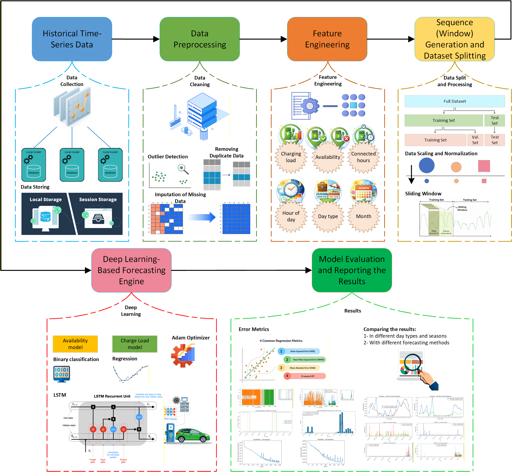

# CPFT: Charge-Point Forecasting Tool  

**Centre for Energy Sustainability** - **University of Salford**

This repository contains a Deep Learning–based **Forecasting Engine (HFE)** for forecasting two key operational signals of Electric Vehicle (EV) charge-points (CPs) at an **hourly** resolution:

- **Availability** (binary: in-use / not in-use)  
- **Charge load** (hourly kWh delivered)

The approach converts session-based charging logs into a continuous hourly time series and trains **Long Short-Term Memory (LSTM)** models to capture temporal dependencies in EV charging behaviour.

---

## Project Overview

EV charge-point usage exhibits strong temporal patterns (daily routines, weekday/weekend effects, and seasonal trends). Accurate forecasts of availability and charge load enable:

- Smart charging and scheduling  
- Charge-point utilisation analysis  
- Grid-aware energy management  
- Improved operational decision-making  

This project implements a **hybrid forecasting strategy**:
1. Train an LSTM classifier to forecast **availability**.  
2. Train an LSTM regressor to forecast **charge load**.  
---


## Pipeline (Workflow)

### 1) Data preprocessing
- Load raw session-level CSV data  
- Parse timestamps (`connectionTime`, `disconnectTime`, `doneChargingTime`)  
- Remove invalid rows and handle missing values  
- Aggregate session energy into **hourly charge load**  
- Create a complete hourly timeline and fill missing hours with **0**  

### 2) Feature engineering
- Availability label per hour (0/1) based on connection intervals  
- Connected hours derived from (`disconnectTime - connectionTime`)  
- Calendar features:
  - Day type (weekday/weekend)  
  - Month (1–12)  
  - Optional seasonal grouping  

### 3) Sequence generation
- Convert hourly time series into supervised samples using a **sliding window**  
- Default look-back window: `seq_len = 50`  
- Chronological split: `65%` training, `35%` test  

### 4) Modeling (LSTM)
Two separate models are trained:

**Availability model**
- Binary classification  
- Loss: `binary_crossentropy`  
- Output activation: `sigmoid`  

**Charge load model**
- Regression  
- Loss: `mean_squared_error`  
- Output constrained to non-negative values  
- Set charge load = 0 if availability = 0  

### 5) Evaluation
Metrics:
- MSE, RMSE, MAE, R²  

Analysis performed across:
- Seasons (Winter, Spring, Summer, Fall)  
- Day types (Weekday vs Weekend)  
- Baseline methods (Last Hour, Same Hour Previous Day)  

### 6) Forecasting
- 24-hour ahead availability forecast  
- 24-hour ahead charge load forecast
  
---

## Requirements

```bash
pip install numpy pandas matplotlib scikit-learn tensorflow
```

Recommended:
- Python 3.9+  
- Jupyter Notebook / JupyterLab  

---

## Outputs

- Forecast plots (availability and charge load)  
- Training convergence plots  
- Seasonal and weekday/weekend performance figures  
- Excel exports with detailed error metrics  

---

## License & Acknowledgement

Developed within the **Centre for Energy Sustainability** at the **University of Salford** and aligned with the Horizon EU-UKRI **DriVe2X** project.

---

## 👥 Contributors

* Peyman Afzali-Gorouh – [https://github.com/peymanafzali](https://github.com/peymanafzali)
* Vahid Vahidinasab – [https://github.com/vahidinasab](https://github.com/vahidinasab)

---

## 🙌 Contributing

Contributions, ideas, and feedback are very welcome!

* Open an issue for bugs, feature requests, or clarifications.
* Submit pull requests for improvements, additional backends, or new tutorials.
* Share your use cases — CPOs, energy communities, EV pilots, DSO research and innovation.

Please read the [CONTRIBUTING.md](CONTRIBUTING.md) for guidelines.

---

## 📜 License

This project is licensed under the **Apache License 2.0** — see the [LICENSE](LICENSE) file for details.

---
