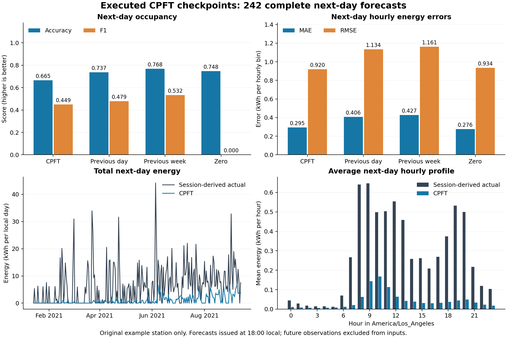

# Executed CPFT model evaluation

The existing checkpoints reproduce the exported one-hour predictions, but their complete next-day forecasts underpredict energy severely and do not beat seasonal occupancy baselines. These checkpoints are not suitable for the proposed station-wide daily service without further model development and validation.

## Models actually executed

Loaded `best_availability.keras` and `best_kwh.keras` with Keras 3.13.2 / TensorFlow 2.20.0 on CPU. The original custom `BinaryAvailabilityModel` definition and its learned blend are preserved. Only named definitions are loaded from the research script; its top-level training code is never run. Loading uses `compile=False`, `safe_mode=True` and the custom class, following the [Keras loading API](https://keras.io/api/models/model_saving_apis/model_saving_and_loading/). All model calls use `training=False`. No model was retrained or modified.

Input shapes are [72, 35] and [72, 42]; the trained 72-hour context is preserved for every horizon. The original UTC calendar convention is retained even though forecast issue/target boundaries use America/Los_Angeles.

## Input verification

Rebuilt the original hourly labels, clipping and features from the original CSV. The maximum feature difference against the exported training frame is 2.14e-07. StandardScaler parameters are reconstructed using only the original training slice; the embedded occupancy lag scaler metadata matches. No scaler is fitted to test or forecast data.

Checkpoint predictions reproduce the export: **True**. Maximum differences: occupancy probability 3.87e-07, energy 1.43e-06 kWh. The occupancy threshold was reselected on the chronological validation windows only: 0.485, matching the export. This threshold was originally tuned for one-step F1; it was not retuned on the day-ahead test.

The reconstructed feature order, scalers, clipping limits and threshold are saved in `reconstructed_preprocessing.json`. They belong to this original station and training snapshot; they are not independently trained artifacts for Amsterdam.

## One-hour results with observed historical windows

| Method | Occupancy accuracy | Occupancy F1 | Energy MAE | Energy RMSE |
| --- | ---: | ---: | ---: | ---: |
| CPFT, ungated energy | 91.58% | 0.832 | 0.219 | 0.626 |
| Last hour | 92.36% | 0.849 | 0.240 | 0.770 |
| Previous day | 73.43% | 0.472 | 0.449 | 1.174 |
| Previous week | 76.77% | 0.532 | 0.429 | 1.163 |

Energy errors are in kWh per hourly bin. These windows use retrospectively reconstructed historical energy, including finalized session information. They reproduce the published example evaluation and are not an operational information-cutoff backtest.

Gating one-hour energy using **predicted** occupancy gives MAE 0.209, RMSE 0.671, and total energy bias -31.80%. Actual occupancy is never used to gate a prediction.

## Complete next-day test

Tested 242 complete local days (5,807 hours), 2021-01-14 through 2021-09-12. Forecasts are issued at 18:00 local the preceding day, use observations strictly before issue, and forecast the six-hour gap plus the whole target day. Scored leads are 7-30 hours. Day lengths: {'24': 241, '23': 1}; the 23-hour spring DST day is included.

| Method | Occupancy accuracy | Occupancy F1 | Energy MAE | Energy RMSE | Energy total bias |
| --- | ---: | ---: | ---: | ---: | ---: |
| CPFT | 66.51% | 0.449 | 0.295 | 0.920 | -84.67% |
| Last hour | 59.19% | 0.375 | 0.305 | 0.970 | -87.60% |
| Previous day (recursive) | 73.74% | 0.479 | 0.406 | 1.134 | -20.99% |
| Previous week | 76.80% | 0.532 | 0.427 | 1.161 | -3.32% |
| Always zero | 74.79% | 0.000 | 0.276 | 0.934 | -100.00% |

CPFT predicts 245.38 kWh against 1600.95 kWh in the reconstructed observations. It predicts 2,069 occupied hours against 1,464, with precision 38.38% and recall 54.23%. Daily energy MAE is 6.017 kWh/day. Low overall errors can hide the predominance of zero-energy hours; the always-zero MAE is lower than CPFT's here.

Without the occupancy output gate, the already-executed energy predictions give MAE 0.306, RMSE 0.913, and total bias -77.90%. This diagnostic changes only output gating, not the gated energy fed back during the rollout.

## Correct recursive use and unavailable features

At each predicted hour, all nonconsecutive lags and rolling means/sample standard deviations are recomputed from the actual preceding raw history plus predictions. Calendar fields advance in UTC, then each feature is scaled using its own original training scaler. The energy main input stays raw as in training; energy outputs use expm1 and nonnegative clipping. Previous-day baselines recurse when their source hour would be after issue, so no baseline peeks at observations unavailable to CPFT.

Historical occupancy/count/connected minutes use connection events up to issue. Historical energy uses only completed records whose disconnect and charging-end timestamps are at or before issue. Ongoing-session final energy totals are excluded; missing live-meter energy is conservatively zero. 55 of 242 origins have ongoing sessions. Publication of completed records/events at their event times is an explicit assumption because ingestion timestamps are unavailable.

Future occupancy count and connected minutes are not predicted by these two checkpoints, but are required input features. The default policy uses predicted binary occupancy times training-only conditional means: count 1.038, connected minutes 51.837. This is an explicit approximation, not observed future information. Sensitivity checks keep the same weights, scaling, lag and calendar rules:

| Future activity policy | Occupancy F1 | Energy MAE | Energy RMSE | Energy bias |
| --- | ---: | ---: | ---: | ---: |
| Training conditional means (default) | 0.449 | 0.295 | 0.920 | -84.67% |
| full_hour | 0.438 | 0.289 | 0.920 | -88.12% |
| carry_last_activity | 0.374 | 0.331 | 0.964 | -66.96% |

`full_hour` assigns count 1 and 60 connected minutes when occupied. `carry_last_activity` freezes these activity features at the last observed value and is a diagnostic of the original carry-forward assumption, rather than the default. All evaluated policies show substantial energy underprediction.

## Limits and next work

This is station 2-39-139-28 from the original example archive, not a model validation across EPIOT stations. Hourly energy truth is uniform allocation of session energy over charging duration and clipped using training-derived limits, rather than independent hourly meter readings. The archive contains 48 sessions with charging-end timestamps later than disconnect. In the scored target hours, 0 hours have positive reconstructed energy while occupancy is zero (0.000 kWh). These data inconsistencies limit physical interpretation; labels were preserved to match the trained preprocessing.

The primary one-step metric advantage does not transfer to reliable next-day demand. Train/validate the model for the intended multi-hour task, include a defined method for unavailable connection features and ongoing-session energy, persist the full preprocessing bundle, and calibrate on day-ahead validation periods before evaluating an untouched test period. Use representative station histories and actual metered hourly energy where available. Exact session arrivals/departures are not established by hourly occupancy scores.

## Reproduction

Create a separate Python 3.12 environment and install `scripts/cpft_evaluation_requirements.txt`. Run `python scripts/evaluate_cpft_models.py` from the repository root. Use `--threads 4` to bound TensorFlow CPU parallelism. `--limit-days 2 --skip-sensitivity --output reports/cpft_model_evaluation_smoke` is only a smoke test. `--render-only` regenerates the report/charts from completed outputs without executing the checkpoints again.

Measured runtime: 74.4 seconds on this machine, including reconstruction, one-step validation/test and three next-day policies. This is not a benchmark across 1,399 points. The JSON records source/checkpoint SHA-256 hashes and library versions; source files and checkpoint weights were unchanged. The web application database was not opened.

Focused validation: `pytest tests/test_cpft_model_inputs.py tests/test_cpft.py tests/test_forecast_store.py -q`. Tests cover feature ordering, exact lag offsets, scaling, future-data perturbation invariance, causal baselines, batched timestamp ordering and both DST transitions. Actual checkpoint reproduction is checked during this evaluation.

Executed focused test results: {'tests': 51, 'failures': 0, 'errors': 0, 'skipped': 0}
