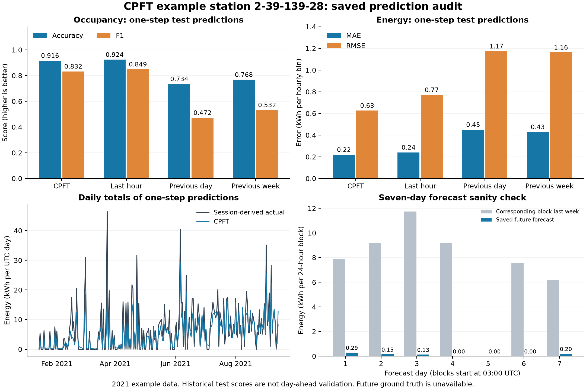

# CPFT prediction statistics

The adapter and database path pass isolated correctness checks. Station-wide day-ahead predictions are not running or validated in the current app.

## Available evidence

The saved export is for station 2-39-139-28, with 5,893 occupancy test hours and 5,836 energy test hours in 2021. These are one-step predictions using observed input windows, not forecasts made once per day. No model was retrained or newly executed for this audit.

The energy labels are reconstructed from session totals by uniform allocation over charging duration and then clipped using training-derived bounds. They are not direct hourly meter readings. Metrics below use the exported test labels, and baselines are joined by exact timestamp over the same test hours.

## Recomputed test statistics

| Method | Occupancy accuracy | Occupancy F1 | Energy MAE (kWh/hour bin) | Energy RMSE (kWh/hour bin) | Energy R² |
| --- | ---: | ---: | ---: | ---: | ---: |
| CPFT | 91.58% | 0.832 | 0.219 | 0.626 | 0.507 |
| Last hour | 92.36% | 0.849 | 0.240 | 0.770 | 0.254 |
| Previous day | 73.43% | 0.472 | 0.449 | 1.174 | -0.732 |
| Previous week | 76.77% | 0.532 | 0.429 | 1.163 | -0.700 |
| Always zero | 74.75% | 0.000 | 0.275 | 0.933 | -0.095 |

CPFT occupancy precision is 83.70%, recall 82.80%, and AUC 0.948. It misses 256 occupied hours and falsely predicts occupancy in 240 hours. It predicts 253 occupied segments versus 225 observed hourly segments; these segments are not exact sessions.

CPFT predicts 1314.22 kWh against 1607.12 kWh in the energy test set, a total bias of -18.22%. Compared with last-hour persistence, MAE improves by 8.91% and RMSE by 18.73%. Occupancy accuracy and F1 are both worse than last-hour persistence.

The raw-session reconstruction differs from the clipped test energy labels in 42 hourly bins. Against those unclipped reconstructed labels, CPFT energy MAE is 0.224 and RMSE is 0.649 kWh. This is a label sensitivity check, not an independent metered evaluation.

## Saved future forecast

The saved forecast covers 2021-09-14 03:00:00+00:00 through 2021-09-21 03:00:00+00:00 (exclusive): 168 hours. It predicts 15 occupied hours (8.93%) and 0.763 kWh in total. The corresponding preceding week contains 64 occupied hours and 51.743 kWh. Forecast energy is 98.53% below that historical total.

This collapse is a diagnostic flag, not a measured future error: the supplied observations end before this forecast period. MAE/RMSE for the future forecast and exact session arrival/departure accuracy are unavailable.

## Integration and database checks

The application database contains 717 stations and 1,399 charging points. Forecast tables present: none. Its latest session start is 2026-01-10 23:45:00.000000. No application data were written.

Real saved CPFT outputs for 6 complete days in America/Los_Angeles were validated, saved twice, and fetched unchanged from a temporary SQLite database. Final row counts: {'forecast_runs': 6, 'forecast_hourly': 144, 'forecast_sessions': 3}. The numeric point identity was created only for this audit and was not mapped to an Amsterdam station. The first forecast timestamp served only as round-trip issue metadata; the export does not provide a verified issue timestamp.

Current automated-suite results: {'tests': 43, 'failures': 0, 'errors': 0, 'skipped': 0}. The automated model calls are stubbed; the additional round-trip check here uses actual saved CPFT outputs.

## Required before trusting daily predictions

1. Connect trained CPFT models and fitted preprocessing artifacts to the app, with fresh observed histories and explicit station mapping.
2. Correct the recursive feature updates: nonconsecutive lag offsets are shifted as adjacent columns, standardized energy/occupancy inputs receive raw values, and several calendar/rolling/cross-target features are held constant. These are source-level findings in CPFT_pipeline_VS_Code_Python.py (lines 720-727, 854-857, 1039-1065). Their exact contribution to the low forecast has not been measured.
3. Run rolling day-ahead backtests with a fixed issue time and only observations available then; compare all forecast leads with day/week baselines across representative stations. The current one-step test scores cannot certify day-ahead performance.
4. Evaluate derived-session timing and flexibility separately: hourly occupied segments cannot uniquely identify individual sessions.

## Reproduction and sources

Run `uv run --with openpyxl --with matplotlib python scripts/analyze_cpft_predictions.py` from the repository root. Optionally pass `--test-results <pytest-junit.xml>` to include an executed test summary.

Source workbook: `others/CPFT-main/CPFT-tool/CPFT_VS_Code_Python/outputs/EV_forecasting_upgraded_results.xlsx`. SHA-256: `b54140b1e87f5bec0e06604fc650c6bc6456cf0208d0be20ed74303a6f194bbe`.

Sheets: hourly_input, metrics_summary, test_availability, test_kwh, forecast_whole_period. The source CSV is Station_2_39_139_28.csv. Detailed numbers, periods, reconciliation checks, and library versions are in statistics.json. The original workbook and CSV are unchanged.
